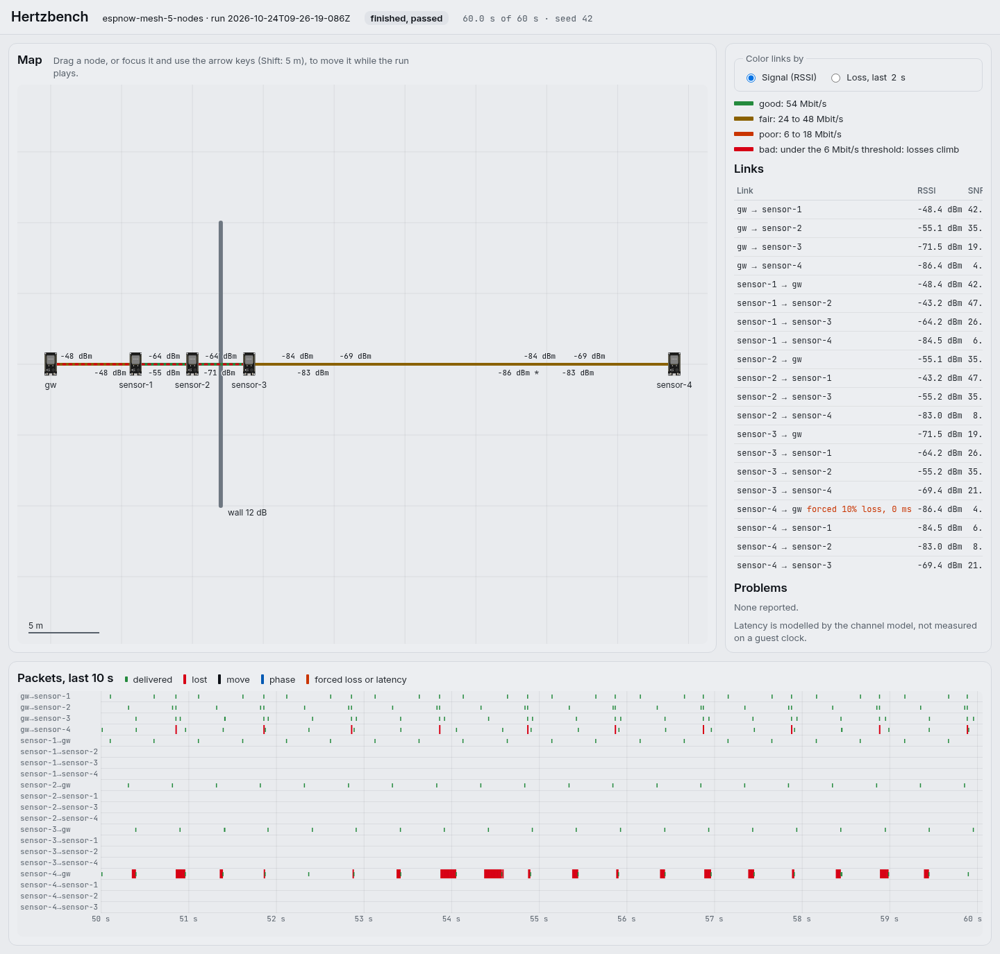

# Hertzbench

**A local, scriptable test bench for the radio network between microcontroller boards.**

Hertzbench runs several boards at once and simulates the air between them. ESP32 boards run real
firmware under QEMU, scripted boards replay traffic, and Android apps run unmodified in the Android
emulator. They all share one simulated network: Wi-Fi/IP, ESP-NOW, BLE, LoRa and nRF24. Each board
has a position in metres, so distance, walls, path loss, latency and loss shape the traffic between
them.

You describe the experiment in a YAML scenario (boards, links, timed faults and assertions), and the
run ends with `RESULT: PASS` or `RESULT: FAIL`, so it fits in CI like any other test.



_Live view of a finished run of
[`espnow-mesh-5-nodes.yaml`](hertzbench/scenarios/examples/espnow-mesh-5-nodes.yaml): five ESP32
boards on real firmware, 60 s, seed 42._

**Website and downloads:** <https://rixmerz.github.io/hertzbench/>

## Why

Testing firmware that talks over radio usually means a desk full of boards, a phone, and results
that change with the weather in the room. Hertzbench replaces the desk with a scenario file: the same
boards, the same positions, the same seed, and the same result on every run. You can then move a
node behind a wall, drop a link, or add interference at second 20, and assert on what the firmware
did about it.

## Features

- **Real firmware.** ESP32 boards run your sketch or `.bin` under QEMU, with Wi-Fi and ESP-NOW
  wired into the simulated air.
- **Scripted boards.** Traffic generators that need no firmware and no QEMU: a scenario with only
  scripted boards runs from the release binary alone.
- **Five radios, one medium.** Wi-Fi/IP, ESP-NOW, BLE, LoRa (SX127x) and nRF24L01+, with distance,
  path loss, walls, retries, latency and loss from a seeded random number generator.
- **Faults on a timeline.** Move nodes, open doors, degrade links and switch on interference at
  given times in the scenario.
- **Assertions and evidence.** Assert on serial output and metrics. Every run writes
  `metrics.json`, `air.pcap` for Wireshark, `events.jsonl` and one serial log per board.
- **Android app nodes.** `board: android` boots an emulator headless, installs your APK and puts the
  app on the same simulated Wi-Fi as the boards. No Android Studio needed.
- **Mobile bridge.** A real phone reaches a simulated node over HTTP, WebSocket, MQTT or any TCP,
  and sees a simulated BLE peripheral through BlueZ (Linux).
- **Built-in services.** Scripted boards can serve HTTP, WebSocket and MQTT (a broker with
  keep-alive, Last Will and client-id takeover) to apps and boards on the simulated network.
- **Live view.** `hertzbench view` shows the nodes on a map, links coloured by signal or loss, drag
  to move, and a packet timeline.
- **MCP server for AI agents.** `hertzbench mcp` lets an agent build, run and steer scenarios, and
  read metrics, serial output and events.
- **Single binary.** Releases for Linux, macOS and Windows, on x64 and arm64, with `SHA256SUMS`.

## Quick start

Download the binary for your system from the
[latest release](https://github.com/Rixmerz/hertzbench/releases/latest) (Linux x64 shown here):

```bash
./hertzbench-linux-x64 examples                  # list the bundled scenarios
./hertzbench-linux-x64 examples udp-3-scripted   # write one out to this folder
./hertzbench-linux-x64 run udp-3-scripted.yaml --out out
```

The report ends with `RESULT: PASS` and the exit status is 0. The run's metrics, packet capture and
logs are in `out/`.

ESP32 boards on real firmware need `libqemu-xtensa`
([e2e-esp32.md](hertzbench/docs/e2e-esp32.md)); Android app nodes need the Android SDK and an AVD
([Android without Android Studio](hertzbench/docs/android.md#android-without-android-studio)).

## A scenario

Three boards in an office, a wall at x = 30 m, and node `c` walking behind it at 2.5 s. An excerpt of
[`udp-3-scripted.yaml`](hertzbench/scenarios/examples/udp-3-scripted.yaml):

```yaml
name: udp-3-scripted
seed: 42
duration: 6s
environment:
  preset: indoor_office
  obstacles:
    - { polygon: [[30, -20], [30, 20]], attenuation_db: 12 }
nodes:
  - id: a
    board: scripted
    position: [0, 0]
    radios: [{ phy: wifi, channel: 5, tx_power_dbm: 15 }]
    firmware:
      send:
        - { to: b, every: 50ms, count: 100, payload: ping }
  # ... nodes b and c
timeline:
  - { at: 2500ms, label: behind-wall, move: { node: c, to: [42, 0] } }
assertions:
  - serial: { node: c, contains: "rx pong", within: 2s }
  - metric: { link: "*->*", phase: start, kind: udp, loss_pct: { lt: 5 } }
```

Swap `board: scripted` for `board: esp32` and a firmware path to run the same experiment on real
firmware ([`udp-3-nodes.yaml`](hertzbench/scenarios/examples/udp-3-nodes.yaml)). The format is
documented in [scenario-format.md](hertzbench/docs/scenario-format.md).

## Documentation

| Topic                                      | Where                                                                              |
| ------------------------------------------ | ---------------------------------------------------------------------------------- |
| Install, status, limits and every command  | [hertzbench/README.md](hertzbench/README.md)                                       |
| Scenario format                            | [scenario-format.md](hertzbench/docs/scenario-format.md)                           |
| Radio and channel fidelity                 | [fidelity.md](hertzbench/docs/fidelity.md)                                         |
| Android apps and the mobile bridge         | [android.md](hertzbench/docs/android.md), [mobile-bridge.md](hertzbench/docs/mobile-bridge.md) |
| MCP and the live view                      | [mcp.md](hertzbench/docs/mcp.md), [view.md](hertzbench/docs/view.md)               |
| What is untested, and how to help          | [community-testing.md](hertzbench/docs/community-testing.md)                       |

## Status and license

Community-maintained. What has not been tested or fixed yet is listed in
[community-testing.md](hertzbench/docs/community-testing.md#known-problems-open-for-contributions);
contributions are welcome.

Free software under AGPLv3. Hertzbench is built on
[Velxio](https://github.com/davidmonterocrespo24/velxio), which does the CPU emulation; the upstream
Velxio README is kept in [docs/VELXIO-README.md](docs/VELXIO-README.md).
