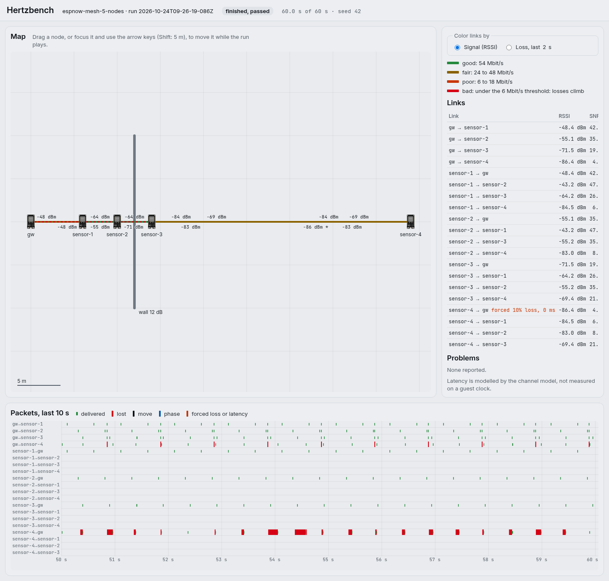
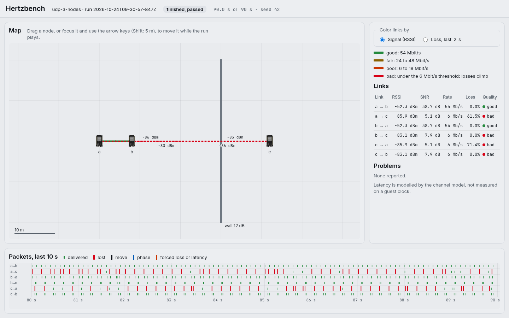
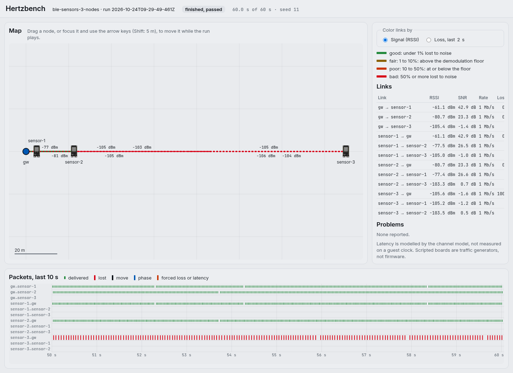
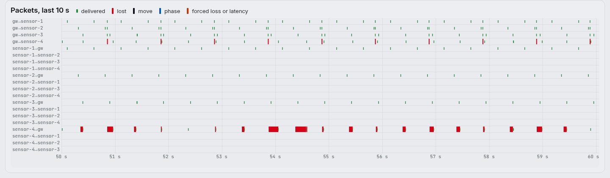

# Hertzbench

Simulate the radio network between microcontroller boards: N boards running real firmware, talking
over simulated wireless links with a distance, a path loss, a latency and a loss. Local, free,
AGPLv3, based on [Velxio](https://github.com/davidmonterocrespo24/velxio) (which does the CPU
emulation).

Website and downloads: **<https://rixmerz.github.io/hertzbench/>** (the page's source is in
[`site/`](../site/)).



_Live view of a finished run of
[`espnow-mesh-5-nodes.yaml`](scenarios/examples/espnow-mesh-5-nodes.yaml): five ESP32 boards on real
firmware, 60 s, seed 42._

The plan is in [docs/PLAN.md](docs/PLAN.md). This is **Phase 1**, N ESP32 boards over Wi-Fi/IP with
a channel model, run headless from a scenario file, **Phase 2**, an MCP server so an AI agent can
build, run and steer those scenarios, **Phase 3**, LoRa and nRF24 radio chips modelled at their SPI
interface, **Phase 4**, ESP-NOW between the boards, **Phase 5**, a mobile bridge that lets a real
phone reach a simulated board over Wi-Fi/IP or BLE, **Phase 6**, BLE between the boards through a
virtual controller on an HCI UART, and **Phase 7**, an optional live view in the browser.

## Quick start

Hertzbench is one binary per system, with nothing else to install. Download the file for your system
from the GitHub Release of a `v*` tag, with `SHA256SUMS`; the file names and the check commands are
in [Install](#install). The example scenarios are read from disk, so run the binary from a checkout
of this repository:

```bash
git clone https://github.com/Rixmerz/hertzbench.git
cd hertzbench/hertzbench                  # the directory that holds scenarios/
# put the downloaded binary here, then:
chmod +x hertzbench-linux-x64
./hertzbench-linux-x64 run scenarios/examples/udp-3-scripted.yaml --out /tmp/hzb-out
./hertzbench-linux-x64 view scenarios/examples/live-3-scripted.yaml   # open http://127.0.0.1:7480/
```

On Windows, use `.\hertzbench-windows-x64.exe` in PowerShell, with the same arguments. The view
serves until Ctrl-C, and its scenario runs for two minutes.

## Status

| Part                                                                                                   | State                                                                                                                                                                                                                                                                                                                                         |
| ------------------------------------------------------------------------------------------------------ | --------------------------------------------------------------------------------------------------------------------------------------------------------------------------------------------------------------------------------------------------------------------------------------------------------------------------------------------- |
| RF engine: medium, nodes, positions, path loss, rate and retries, jitter, loss, seeded RNG, event log  | done, unit-tested on a manual clock                                                                                                                                                                                                                                                                                                           |
| `qemu-wifi-l2` adapter: each board's QEMU network device on the engine instead of SLIRP                | done, tested against a fake QEMU peer over real sockets                                                                                                                                                                                                                                                                                       |
| Orchestrator and CLI: `hertzbench run`, `validate`                                                     | done, tested through the real CLI                                                                                                                                                                                                                                                                                                             |
| `metrics.json`, `air.pcap`, `events.jsonl`, assertions                                                 | done                                                                                                                                                                                                                                                                                                                                          |
| ESP32 boards under QEMU                                                                                | **run on real firmware** (2026-10-23) with a libqemu built from the public QEMU fork, no root or Docker: UDP between three boards passes, and ESP-NOW between five passes with a patch to the fork (2026-10-24); see [docs/e2e-esp32.md](docs/e2e-esp32.md#results-on-real-firmware) for every scenario, its result and the exact commands    |
| MCP server: `hertzbench mcp`, 23 tools, examples and fidelity table as resources, live move and fault  | done, tested through the real `hertzbench mcp` process with scripted boards; ESP32 through MCP not run (the ESP32 runs used the CLI)                                                                                                                                                                                                          |
| View: `hertzbench view`, map, links colored by RSSI or loss, drag to move, packet timeline             | done, tested over HTTP and in headless Chromium with scripted boards, dragging a node included; **on real firmware** (2026-10-24) `udp-3-nodes`, `espnow-mesh-5-nodes`, `lora-gateway-6-nodes` and `ble-sensors-3-nodes` pass in the view; dragging an ESP32 node not tried                                                                   |
| `docker-compose.hertzbench.yml`                                                                        | not started                                                                                                                                                                                                                                                                                                                                   |
| ESP-NOW (F1): action frames from the QEMU fork's MAC on the switch, the 10 ms ACK wait, 802.11 capture | done against a model of the fork, tested on a manual clock and with scripted boards; **`espnow-mesh-5-nodes.yaml` passes 7/7 on real firmware** (2026-10-24) with a small patch to the fork's Wi-Fi MAC (its 20-frame injection queue never resumed reading, [docs/upstream-sync.md](docs/upstream-sync.md) patch 3), see [ESP-NOW](#esp-now) |
| LoRa (SX127x) and nRF24L01+ chip models over `spi-link` (Phase 3)                                      | done; `lora-gateway-6-nodes.yaml` **passes on real firmware** (arduino-LoRa on an SX1276 model). No nRF24 example has an ESP32 board                                                                                                                                                                                                          |
| BLE (F3, Phase 6): virtual HCI controller per node on the chip-level air, ESP32 HCI UART relay         | done, tested on a manual clock and with scripted hosts; `ble-sensors-3-nodes.yaml` **passes on real firmware** (Bluedroid host-only, ESP-IDF v5.3.6), see [BLE](#ble)                                                                                                                                                                         |
| Mobile bridge (Phase 5): IP proxy with mDNS (5a), BlueZ GATT mirror (5b), the phone as a node          | done, tested with scripted boards and stand-ins; **on real firmware** the IP bridge serves the ESP32's `WebServer` to the host's `curl` and BlueZ advertises the firmware's GATT on `hci0`; **no phone or LAN mDNS from another host used**, see [Mobile bridge](#mobile-bridge)                                                              |

## Install

Hertzbench runs on Linux, macOS and Windows, on x64 and arm64. The CI runs lint, type check and the
test suite on all three systems (`.github/workflows/hertzbench-ci.yml`). There are two ways to get
it.

**A release binary** (nothing else to install). Download the file for your system from the GitHub
Release of a `v*` tag, together with `SHA256SUMS`, and check it:

| System  | x64                          | arm64                          |
| ------- | ---------------------------- | ------------------------------ |
| Linux   | `hertzbench-linux-x64`       | `hertzbench-linux-arm64`       |
| macOS   | `hertzbench-macos-x64`       | `hertzbench-macos-arm64`       |
| Windows | `hertzbench-windows-x64.exe` | `hertzbench-windows-arm64.exe` |

```bash
# Linux and macOS
sha256sum -c --ignore-missing SHA256SUMS      # macOS: shasum -a 256 -c --ignore-missing SHA256SUMS
chmod +x hertzbench-linux-x64 && ./hertzbench-linux-x64 --help
# macOS only, the first run of an unsigned download: xattr -d com.apple.quarantine hertzbench-macos-arm64
```

```powershell
# Windows (PowerShell)
Get-FileHash .\hertzbench-windows-x64.exe -Algorithm SHA256   # compare with the line in SHA256SUMS
.\hertzbench-windows-x64.exe --help
```

A binary carries the permissions `deno task lan` grants (network, read, write, run, env). Rename or
copy it to `hertzbench` / `hzb` somewhere on your PATH. To build the binaries yourself, from this
directory: `deno task compile` (all six, into `dist/`) or `deno task compile linux-x64`
(`deno task compile --list` names them).

**From source.** Install [Deno](https://deno.com) 2.x, then use `deno task hertzbench ...` from this
directory:

| System  | Deno                                                                         |
| ------- | ---------------------------------------------------------------------------- |
| Linux   | `curl -fsSL https://deno.land/install.sh \| sh`                              |
| macOS   | `brew install deno` or the same script                                       |
| Windows | `winget install DenoLand.Deno` or `irm https://deno.land/install.ps1 \| iex` |

What differs by system:

- **Python 3** is needed only for the ESP32 boards' compile helper, the ESP32 worker, and a few
  tests (`python3` on Linux and macOS, `python` on Windows; `HERTZBENCH_PYTHON` overrides it).
- **ESP32 under QEMU** needs `libqemu-xtensa` for your system (`QEMU_ESP32_LIB`), see
  [docs/e2e-esp32.md](docs/e2e-esp32.md). The scripted boards need nothing.
- **The BLE mobile bridge is Linux only** (it uses BlueZ). On Windows and macOS a scenario with a
  BLE bridge is refused before it starts, with a message saying so; the alternatives are in
  [docs/mobile-bridge.md](docs/mobile-bridge.md#windows-and-macos). The IP bridge works everywhere.
- **Ctrl-C** stops a run cleanly on every system; SIGTERM only exists on Linux and macOS.
- **Timers on Windows** tick every 15.6 ms. Scripted boards on a wall clock cannot meet the 10 ms
  ESP-NOW ACK wait there, so the ESP-NOW ACK rates of scripted scenarios read low on Windows.
- Tests that cannot run on a given system are listed in
  [docs/missing-tests.md](docs/missing-tests.md).

## First run from source (no QEMU needed)

Needs [Deno](https://deno.com) 2.x.

```bash
cd hertzbench
deno task hertzbench run scenarios/examples/udp-3-scripted.yaml --out /tmp/hzb-out
```

It runs three **scripted** boards (a traffic generator, not firmware) for 6 s. Board `c` walks
behind a wall at 2.5 s; the report shows its links to `a` slowing down and losing frames while the
link to `b` holds. It prints per-link RSSI, loss and latency, a pass or fail per assertion, and
writes `metrics.json`, `air.pcap` (open it in Wireshark) and `events.jsonl` to `/tmp/hzb-out`.

Excerpt from one run, with the phase tables left out:

```
Links, whole run
  link  sent  delivered  loss   p50 ms  p95 ms  p99 ms  rssi dBm  snr dB  attempts
  ----  ----  ---------  -----  ------  ------  ------  --------  ------  --------
  a->b  200   200        0.0%   0.29    0.46    0.51    -52.3     38.7    1.00
  a->c  189   155        18.0%  0.38    4.89    7.13    -71.2     19.7    2.71
  b->a  200   200        0.0%   0.30    0.47    0.50    -52.3     38.7    1.00
  b->c  200   200        0.0%   0.38    0.64    0.72    -65.4     25.6    1.01
  c->a  176   151        14.2%  0.40    6.03    15.51   -70.2     20.8    2.56
  c->b  200   200        0.0%   0.35    0.64    0.71    -65.4     25.6    1.00

Assertions
  PASS  serial a contains "dhcp bound ip=192.168.4.11" within 1000 ms  (seen at 8.765 ms)
  PASS  serial c contains "rx pong" within 2000 ms  (seen at 17.125 ms)
  PASS  metric *->* (phase start, udp frames): loss_pct lt 5, latency_p95_ms lt 2  (6 link(s) satisfy it)
  PASS  metric c->a (phase behind-wall, udp frames): loss_pct gt 20, latency_p95_ms gt 4  (1 link(s) satisfy it)
  PASS  metric c->b (phase behind-wall, udp frames): loss_pct lt 10  (1 link(s) satisfy it)

RESULT: PASS
```

The same experiment with three ESP32 boards is `scenarios/examples/udp-3-nodes.yaml`; it needs
libqemu, see [docs/e2e-esp32.md](docs/e2e-esp32.md).



_Live view of `udp-3-nodes.yaml` on real firmware, 90 s: the wall stands between `b` and `c`._

```
hertzbench run <scenario.yaml> [--out DIR] [--seed N] [--quiet]
hertzbench validate <scenario.yaml>
hertzbench view <scenario.yaml> [--port N] [--out DIR] [--seed N]
hertzbench mcp [--workspace DIR] [--view-port N]
```

To get the `hertzbench` and `hzb` commands on your PATH (they go to Deno's bin directory, usually
`~/.deno/bin`), run `deno task install-cli` once from this directory. Without it, use
`deno task hertzbench ...` from here as above.

`hzb` is the short alias. Exit status: 0 passed, 1 an assertion failed, 2 invalid scenario or a host
that cannot run it, 130 interrupted (boards are stopped first).

## ESP-NOW

```bash
cd hertzbench
deno task hertzbench run scenarios/examples/espnow-mesh-scripted.yaml --out /tmp/hzb-espnow
```

A gateway and four sensors on channel 1, scripted boards again. The sensors send readings to the
gateway over unicast ESP-NOW and the gateway broadcasts a beacon. A wall stands between the gateway
and the two farther sensors. At 3 s sensor-4 walks away: its frames need more retries, some run past
the 10 ms the QEMU fork waits for an ACK, most are lost. The report has an ESP-NOW table with each
link's sends as the sender's firmware sees them (`acked`, `frame_lost`, `ack_timeout`, `no_ack`) and
the round trip of each ACK. `air-80211.pcap` holds the frames as 802.11 for Wireshark.

With real firmware the boards run the production ESP-NOW stack. The fork's Wi-Fi MAC model turns
their 802.11 action frames into pseudo-Ethernet on the same netdev as Wi-Fi/IP, and the engine
carries them. `scenarios/examples/espnow-mesh-5-nodes.yaml` and its sketches in
`scenarios/examples/fw/espnow-*` do it with five ESP32 boards. They need a libqemu built with a
small patch to the fork's Wi-Fi MAC ([docs/upstream-sync.md](docs/upstream-sync.md), patch 3) and
the sketch toolchain. With it they **pass on real firmware** (2026-10-24, 7/7), with the environment
of [docs/e2e-esp32.md](docs/e2e-esp32.md#results-on-real-firmware) set:

```bash
cd hertzbench
deno task hertzbench run scenarios/examples/espnow-mesh-5-nodes.yaml --out /tmp/hzb-espnow
```

The numbers of each run are in [docs/e2e-esp32.md](docs/e2e-esp32.md#the-esp-now-example). What the
engine models, the 10 ms ACK rule, and what is read from the fork's code rather than measured are in
[docs/fidelity.md](docs/fidelity.md#esp-now).

## BLE

```bash
cd hertzbench
deno task hertzbench run scenarios/examples/ble-sensors-scripted.yaml --out /tmp/hzb-ble
```

A central and three sensor peripherals, scripted hosts again. The central connects to the three
through its filter accept list, and each sensor notifies a reading every 200 ms. At 4 s sensor-3
walks out of range: its packets stop, both sides drop the connection on the 1 s supervision timeout
(reason 0x08), and the central keeps scanning for it. The report lists every connection and
disconnection, and per link the packets on the air (`ble-adv`, `ble-data`) and the host-to-host ACL
data (`ble-acl`, whose latency includes waiting for connection events and retransmissions).
`air.pcap` holds the air as LE link-layer packets for Wireshark, and `hci-<node>.btsnoop` each
node's HCI, readable by Wireshark and by BlueZ's `btmon -r`.

The QEMU fork has no Bluetooth controller, so BLE is **F3** (ADR
[0002](docs/adr/0002-ble-approach.md)): the firmware runs its real Bluedroid host stack, built
host-only, and sends HCI over UART1; the board relays that UART to a link-layer controller the
engine plays. The binary differs from production by that build option and the UART driver.
`scenarios/examples/ble-sensors-3-nodes.yaml` runs three ESP32 sensors built from
`scenarios/examples/fw/ble-sensor` (an ESP-IDF project) and **passes** on real firmware (run on
2026-10-23, 6/6 assertions): see [docs/e2e-esp32.md](docs/e2e-esp32.md#the-ble-example). What the
controller models and what it leaves out are in [docs/fidelity.md](docs/fidelity.md#ble).



_Live view of `ble-sensors-3-nodes.yaml`: ESP32 sensors on real firmware, the central a scripted
host._

## Mobile bridge

```bash
cd hertzbench
deno task hertzbench run scenarios/examples/bridge-web-scripted.yaml
curl http://127.0.0.1:8080/status     # in another terminal, while it runs
```

A scripted web node serves HTTP (and WebSocket on the same port) and an MQTT broker; the bridge's
station stands 3 m from it on the medium. Every connection to the host's port 8080 or 1883 becomes
the bridge's own TCP connection to the node, so its segments pay the channel model from the bridge's
position: at 40 s the bridge walks away and requests slow down. With `listen: 0.0.0.0` and
`deno task lan run ...`, a phone on the same Wi-Fi reaches it, and mDNS advertises it as
`web-80._http._tcp.local`.

On BLE, `scenarios/examples/bridge-ble-scripted.yaml` mirrors a simulated peripheral's GATT server
through BlueZ: a phone connects to the host, and each read, write and subscription is replayed from
the bridge's node on the simulated air. That one needs Linux, `bluetoothd` and PyGObject. What each
bridge models and leaves out (the phone-to-host leg is real, not modelled), how to run it and how it
is tested are in [docs/mobile-bridge.md](docs/mobile-bridge.md). No Velxio file changed.

## Use it from Claude Code (MCP)

```bash
claude mcp add hertzbench -- hertzbench mcp --workspace /path/to/your/project
```

The agent gets `list_boards`, `create_scenario`, `validate_scenario`, `run_scenario`, `get_status`,
`get_serial`, `get_metrics`, `move_node`, `inject_fault` and `stop`. As resources it gets the
example scenarios, the scenario format and the fidelity table. A run plays in the background, so the
agent can move a node or break a link while it runs and read the effect in the metrics.
`scenarios/examples/live-3-scripted.yaml` is a two-minute run made for that. Every file the server
writes stays inside its workspace. Registration without installing, the tool reference and the ESP32
setup are in [docs/mcp.md](docs/mcp.md).

## Watch it live (optional)

```bash
deno task hertzbench view scenarios/examples/live-3-scripted.yaml --out /tmp/hzb-view
```

Open the address it prints (`http://127.0.0.1:7480/`). The page draws the nodes on a map, colors
each link by its signal or by its loss over the last 2 s, and plots every frame on a timeline. Drag
a node, or focus it and use the arrow keys, to move it while the run plays: the move goes through
the same `move_node` tool an agent uses. `hertzbench mcp --view-port 7480` draws the agent's run the
same way. No build step and no Velxio patch; see [docs/view.md](docs/view.md).



_The last 10 s of the `espnow-mesh-5-nodes.yaml` run in the first screenshot: red marks are frames
lost on the links to `sensor-4`, the far sensor._

## How it works

```
board 1 (QEMU) ──┐                                   ┌── metrics.json
board 2 (QEMU) ──┼─ socket netdev ─ adapter ─ engine ┼── air.pcap
board N (QEMU) ──┘   (loopback TCP)     switch + channel model   └── events.jsonl
```

- Each board's Wi-Fi NIC is a QEMU `socket` netdev to its own loopback port. The adapter reads
  Ethernet frames from it and hands them to the engine, and writes the engine's deliveries back.
- The engine is a static layer-2 switch. For every frame and every receiver it computes RSSI and SNR
  from the positions, picks a rate, rolls retries and loss, and delivers the frame after the
  modelled delay. All randomness comes from the scenario seed.
- A virtual gateway at `192.168.4.1` answers ARP and DHCP with a static lease per board; there is no
  DNS.
- The fidelity of every part is printed in the report. See [docs/fidelity.md](docs/fidelity.md) for
  the model, what it leaves out, and the clock caveat: **latency is modelled, not measured**.

## Layout

```
engine/          RF engine: channel model, medium, switch, gateway, ESP-NOW framing, LoRa, nRF24
                 and BLE PHYs, metrics, pcap, a small TCP for the stations it plays
adapters/        qemu-wifi-l2 (QEMU socket netdev <-> engine), eFuse image builder, spi-link and the
                 LoRa and nRF24 chip models, ble-hci (virtual BLE controller, H4, btsnoop)
orchestrator/    scenario parser, runner, assertions, report, boards (esp32, scripted, ESP-NOW fork
                 model, scripted LoRa/nRF24/BLE hosts, scripted TCP servers, ATT/GATT)
bridge/          mobile bridge: ip/ (host TCP proxy, mDNS), ble/ (GATT mirror, BlueZ helper)
mcp/             MCP server: JSON-RPC over stdio, tools, resources, the live run
view/            the live view: loopback HTTP server, scene model, static page (no build)
cli/             hertzbench run | validate | view | mcp
scenarios/       examples/
tests/           deno tests (engine, adapter, scenario, orchestrator, CLI, MCP, view)
docs/            PLAN, discovery, ADRs, fidelity, scenario format, e2e, upstream sync
brand.ts         the product name, in one place
```

## Tests

```bash
cd hertzbench
deno task test      # unit + adapter + CLI, MCP and view end to end; no QEMU needed
deno task check     # type check
deno lint && deno fmt --check
```

The Velxio core patch has its own tests: `pytest test/backend/unit/test_esp32_wifi_l2_args.py` from
the repository root. It touches one Velxio file; see [docs/upstream-sync.md](docs/upstream-sync.md).
BLE and the mobile bridge touch no Velxio file. The BlueZ helper's test runs it on a private D-Bus
(`dbus-run-session`) against a fake `bluetoothd`, and skips when `dbus-run-session` is missing. One
CLI test decodes a node's HCI capture with BlueZ's `btmon` when it is installed, and skips that
check when it is not.

## Docs

- [docs/scenario-format.md](docs/scenario-format.md): every scenario field and the `metrics.json`
  layout
- [docs/fidelity.md](docs/fidelity.md): fidelity levels, the channel model, what is not modelled
- [docs/mcp.md](docs/mcp.md): the MCP server, its tools and resources, registering it with Claude
  Code
- [docs/mobile-bridge.md](docs/mobile-bridge.md): a real phone to a simulated board, over IP (with
  mDNS) or BLE (through BlueZ)
- [docs/view.md](docs/view.md): the live view, what its colors mean, what it reuses from Velxio
- [docs/e2e-esp32.md](docs/e2e-esp32.md): running the ESP32 example, and what to verify on the first
  run
- [docs/upstream-sync.md](docs/upstream-sync.md): the Velxio patches and the sync policy
- [docs/discovery.md](docs/discovery.md) and [docs/adr/](docs/adr/): Phase 0 findings and decisions

Hertzbench is based on Velxio. The name and logo of Velxio are not ours to use as a brand.
